# BNG and the housing market: tests run, models and results

*Rebuild report, 27 November 2026. Pipeline in `Dissertation/Pipeline/` (not yet committed).
Figures: `output/figures/` (PNG and PDF). Tables: generated from the saved results by
`src/report_tables.py` (`output/tables/tables.md`), reproduced here. Per-design notes with the
pre-specifications (Part A) and full results (Part B) are in `notes/`.*

---

## 1. What this covers

The question is how England's mandatory Biodiversity Net Gain (BNG; Schedule 7A TCPA 1990,
mandatory from 12 February 2024 for major and 2 April 2024 for small sites) affected housing
supply (planning decisions), demand (house prices) and, as a check, biodiversity around gain
sites. The toy model (FINDINGS section 2) treats BNG as a cost per habitat unit lost
(`tau = (1+theta) b p_B + f`) and, possibly, a local amenity. Its predictions frame every test:

| Channel | Prices P | Homes H | Land rent R |
|---|---|---|---|
| Cost | + | - | - |
| Gain-site amenity | + | + | + |
| Signal of nearby development | - | - | - |

In the reduced-form DiD `Y = mu_j + lambda_t + beta (Treat x Post) + e`, the cost channel gives
`beta_H = -Delta tau / (D + C) < 0` for quantities. A higher grant rate is the selection
reading (weaker schemes screened out before submission).

Everything below was rebuilt from raw data with new code, after first reproducing every pilot
number (section 3). Each new design was pre-specified in writing before it was run.

## 2. Data and pipeline

| Stage | Raw inputs | Script | Output |
|---|---|---|---|
| Gain Site Register | Natural England API pulls, 12 Oct and 6 Nov 2026 | `register.py` | 424 sites (423 with location) |
| Planning panel, England | MHCLG PS1/PS2 to 2026 Q2 | `planning_panel.py` | 306 LPAs x 46 quarters |
| Planning panel, Wales | DMQS, 36 releases | `planning_panel.py` | 25 authorities x 41 quarters |
| Intensity score | Living England 2022-23, LAD May 2025, national parks | `intensity_grid.py`, `intensity_score.py` | score per LPA |
| Nutrient neutrality | Defra list (LGA paper, Mar 2022), NE catchments | `nutrient_neutrality.py` | NN status, catchment share |
| Prices | HMLR Price Paid 2018-2026, ONSPD Aug 2026 | `housing_inputs.py`, `hedonic_base.py` | 6.66 m sales, hedonic residuals |
| Gain-site context | register + Living England | `gainsite_context.py` | built-up share around sites |
| EPC | domestic EPC bulk zip (streamed) | `epc_extract.py` | 3.86 m certificates near sites |
| Birds | eBird Basic Dataset GB, Jan 2015-Oct 2026 (streamed) | `ebird_counts.py`, `ebird_species.py` | 1.43 m usable checklists in England |

Environment: conda `bng-diss` (Python 3.12; `environment.yml`, versions frozen in
`environment.lock.yml`). Tests: 36 unit tests (`tests/`), all passing.

## 3. Validation of the pilot

Every target in FINDINGS section 6 was reproduced before anything new was estimated.

| Target | Pilot | Rebuild |
|---|---|---|
| 1 Clean register | 424 sites (414/8/2); Oct 402 from 404 rows | identical; 0 field differences |
| 2 Planning panels | 306 LPAs x 46 q; Wales 25 x 41 | identical (0 differing values) |
| 3 Pilot 1 grant rates | major 80.0 -> 84.5; minor 71.5 -> 74.6; hh 89.7 -> 90.3 | 79.96 -> 84.45; 71.55 -> 74.55; 89.67 -> 90.27 |
| Intensity score | 306 units, 40 variants | identical cell counts and scores (scipy instead of OpenCV) |
| 4 Intensity DiD | beta 0.0361, SE 0.0177; tercile 0.0541 | identical |
| 4b Robustness (18 checks), event study | full tables | identical to 1e-13, except check 5 (pilot error, below) |
| 5 SDID England vs Wales | DiD 0.061973; SDID 0.017323 | identical; 105 leave-one-out estimates to 1e-9 |
| 6 Gain-site prices | six estimates | five identical; SDID within donor-draw noise (0.1 SE) |

**Errors found in the pilot code** (none changes a conclusion):
1. *Check 5 (LPA trends removed):* the first step (LPA dummies + quarter dummies + LPA x t) is
   rank-deficient by one; statsmodels' pseudo-inverse returned slopes shifted by about 1e10
   and the rounding error moved beta by 4e-4 (0.0285 -> correct 0.0290; confirmed by a
   full-rank parametrisation).
2. *Synthetic control (comparison column only):* the unpenalised solver stopped before
   convergence (differences up to 3e-6).
3. *Gain-site SDID:* the random donor draw depends on the order in which scipy returns
   neighbouring postcodes, so the same seed picks different donors across versions. Over 40
   draws the estimate has SD 0.0034, a variance the reported placebo SE omits.
4. *Sample:* the price pilot used every row of the 12 October register, so two amended sites
   were counted twice; the rerun on the deduplicated 6 November register fixes this.

---

## 4. Supply: did BNG change planning decisions?

### 4.1 Treatment intensity

BNG bites hardest where land next to settlements, where new housing goes, is valuable
habitat. **Intensity** = share of developable land within 500 m of settlements (built-up
patches >= 10 ha) whose closest statutory-metric habitat has Medium or higher
distinctiveness (Living England 2022-23, crosswalk in `inputs/`; scores TODO: verify against
the statutory metric). It proxies *b*, habitat units lost per dwelling.

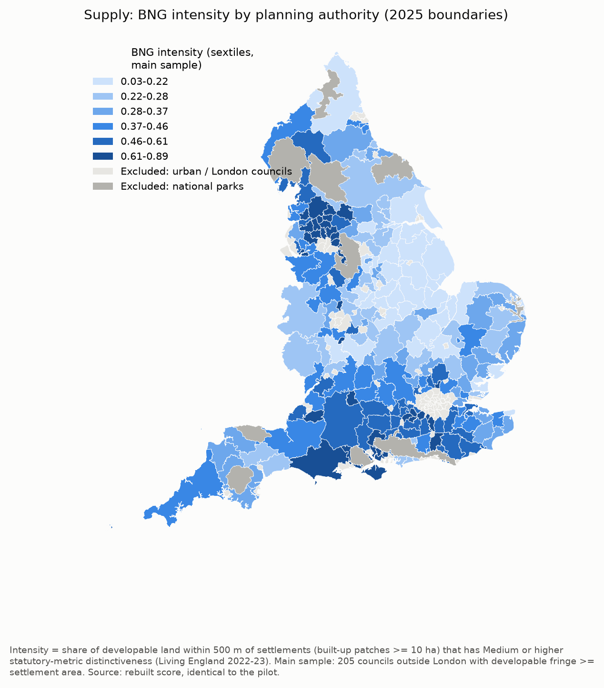
*Figure S1. Intensity by planning authority. Main sample: 205 councils outside London whose
developable fringe is at least as large as their settlements (urban councils score high for
the wrong reason: little, mostly protected, fringe land).*

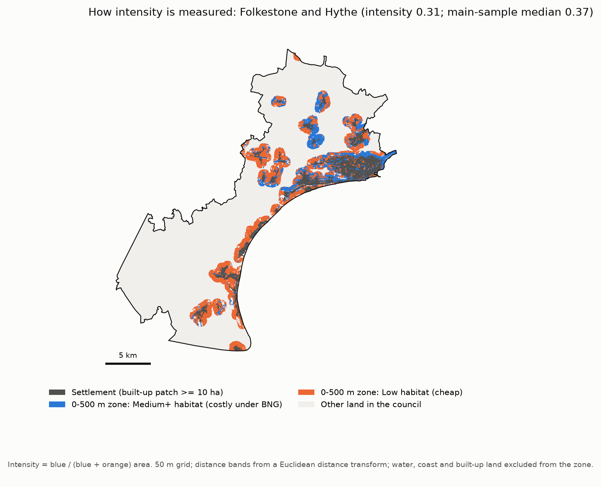
*Figure S2. How the score is built for one council: blue / (blue + orange).*

### 4.2 Model

    y_it = a_i + l_t + beta (I_i x Post_t) + e_it

*i* = LPA (205), *t* = quarter 2015 Q1-2026 Q2, dropping 2023 Q4-2024 Q2 (fee rise; decisions
then mostly concern pre-BNG applications); Post = 2024 Q3 onwards; *I* standardised across
LPAs (beta per SD); SE clustered by LPA. Outcomes: log(1 + major + minor dwelling decisions);
dwelling grant rate (weighted by decisions); log(1 + householder decisions) as a placebo
(BNG-exempt). Estimated with pyfixest and by a hand-coded two-way within estimator (agree to
1e-17).
*Identifying assumption:* absent BNG, high- and low-intensity councils would have moved in
parallel after 2024 Q3 (strong parallel trends for a continuous dose).

### 4.3 Results

### Table S1. Intensity DiD, baseline (205 councils, 2015 Q1-2026 Q2 excl. 2023 Q4-2024 Q2)

| Outcome                                  | beta per SD (SE, pyfixest)   |   SE, pilot convention |     p |   LPAs |   Obs |
|:-----------------------------------------|:-----------------------------|-----------------------:|------:|-------:|------:|
| log(1 + dwelling decisions)              | +0.0361 (0.0175)             |                 0.0177 | 0.043 |    205 |  8815 |
| dwelling grant rate                      | +0.0075 (0.0059)             |                 0.0059 | 0.204 |    205 |  8794 |
| log(1 + householder decisions) [placebo] | +0.0104 (0.0074)             |                 0.0075 | 0.166 |    205 |  8815 |

The pilot's SE (0.0177) counts the nested LPA effects in the small-sample correction;
0.0175 (not counting them, the fixest convention) is the one to report.

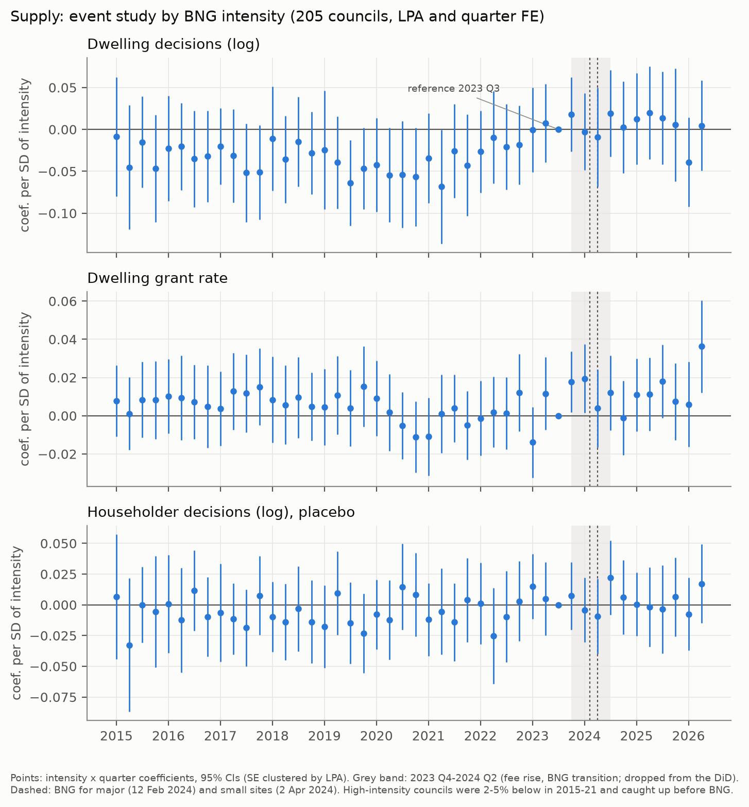
*Figure S3. Event study (reference 2023 Q3). High-intensity councils were 2-5% below in
2015-21 and caught up before BNG; after BNG there is no further movement relative to 2023.*

### Table S2. Robustness: beta per SD of intensity x Post (SE clustered by LPA)

| Check                                    | Dwelling decisions (log)   | Dwelling grant rate   | Householder (placebo)   |
|:-----------------------------------------|:---------------------------|:----------------------|:------------------------|
| 1 baseline (main sample)                 | +0.036 (0.017) p=0.04      | +0.008 (0.006) p=0.20 | +0.010 (0.007) p=0.16   |
| 2 all councils                           | +0.003 (0.018) p=0.85      | +0.011 (0.005) p=0.03 | +0.024 (0.007) p<0.01   |
| 3 main + London                          | +0.010 (0.022) p=0.65      | +0.012 (0.006) p=0.04 | +0.026 (0.008) p<0.01   |
| 4 region x quarter FE                    | +0.042 (0.023) p=0.07      | +0.017 (0.007) p=0.01 | +0.005 (0.008) p=0.59   |
| 5 LPA trends (pre-fitted) removed        | +0.029 (0.019) p=0.13      | +0.015 (0.007) p=0.03 | +0.006 (0.010) p=0.59   |
| 6 window 2021Q1+                         | +0.027 (0.017) p=0.11      | +0.012 (0.006) p=0.03 | +0.008 (0.007) p=0.24   |
| 7 intensity: 0-250 m                     | +0.035 (0.017) p=0.04      | +0.008 (0.006) p=0.19 | +0.009 (0.007) p=0.20   |
| 7 intensity: 0-1 km                      | +0.037 (0.018) p=0.04      | +0.007 (0.006) p=0.27 | +0.011 (0.007) p=0.14   |
| 7 intensity: settlements >= 50 ha        | +0.035 (0.017) p=0.04      | +0.006 (0.006) p=0.29 | +0.008 (0.007) p=0.24   |
| 7 intensity: alt crosswalk               | +0.036 (0.016) p=0.02      | +0.003 (0.006) p=0.60 | +0.008 (0.007) p=0.25   |
| 7 intensity: mean distinctiveness        | +0.029 (0.017) p=0.09      | +0.006 (0.006) p=0.30 | +0.011 (0.008) p=0.16   |
| 8 top vs bottom tercile                  | +0.054 (0.038) p=0.16      | +0.017 (0.014) p=0.22 | +0.009 (0.016) p=0.59   |
| 9 PPML counts                            | +0.044 (0.016) p<0.01      | -                     | -0.000 (0.006) p=0.98   |
| 10 drop anomalies, merged, DC hosts      | +0.033 (0.018) p=0.07      | +0.007 (0.006) p=0.27 | +0.009 (0.008) p=0.26   |
| 13 drop nutrient-neutrality LPAs         | +0.041 (0.021) p=0.05      | +0.002 (0.007) p=0.75 | +0.018 (0.009) p=0.05   |
| 14 NN x quarter FE                       | +0.035 (0.017) p=0.05      | +0.007 (0.006) p=0.23 | +0.010 (0.007) p=0.17   |
| 15 region x quarter + NN x quarter FE    | +0.039 (0.023) p=0.09      | +0.017 (0.007) p=0.02 | +0.005 (0.009) p=0.57   |
| 16 NN catchment share x quarter          | +0.038 (0.017) p=0.03      | +0.007 (0.006) p=0.23 | +0.011 (0.007) p=0.13   |
| 17 drop LPAs >=10% in NN catchment       | +0.040 (0.019) p=0.04      | +0.006 (0.007) p=0.34 | +0.014 (0.008) p=0.10   |
| 18 region x quarter + NN share x quarter | +0.045 (0.023) p=0.06      | +0.017 (0.007) p=0.01 | +0.005 (0.009) p=0.56   |
| 12 placebo: fake Post 2021Q1-2023Q3      | +0.014 (0.013) p=0.31      | -0.007 (0.004) p=0.12 | +0.003 (0.007) p=0.67   |
| 11 leave one region out (range)          | +0.027 to +0.041           | +0.002 to +0.013      | -0.005 to +0.018        |

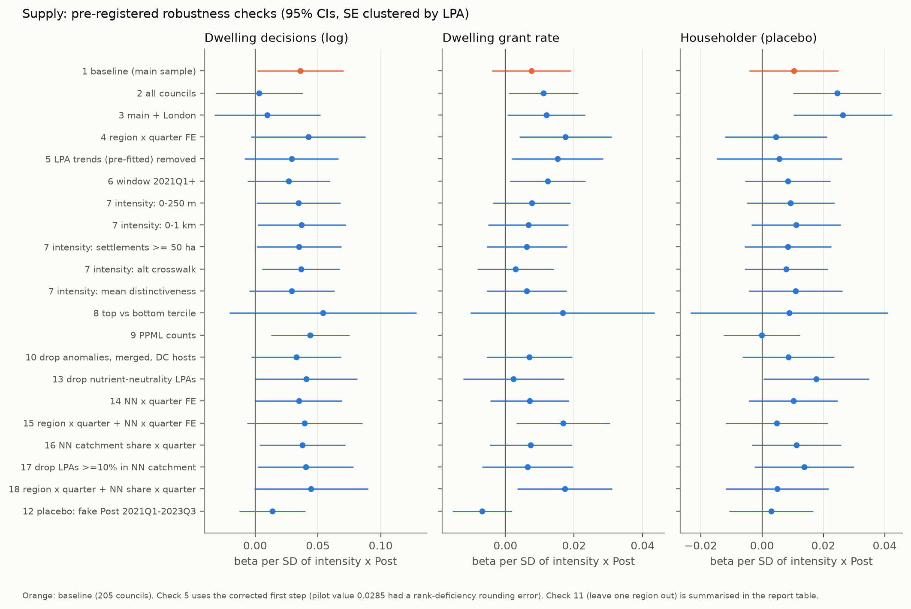
*Figure S4. The same checks with 95% CIs.*

### Table S3. Pre-BNG linear differential trend (2015 Q1-2023 Q3, per year per SD)

| sample       | outcome                                |   slope_per_year |     se |      p |
|:-------------|:---------------------------------------|-----------------:|-------:|-------:|
| main         | log(1+dwelling decisions)              |           0.0012 | 0.0029 | 0.6846 |
| main         | dwelling grant rate                    |          -0.0013 | 0.0009 | 0.1695 |
| main         | log(1+householder decisions) [placebo] |           0.0008 | 0.0017 | 0.6539 |
| all_councils | log(1+dwelling decisions)              |          -0.0028 | 0.0027 | 0.3063 |
| all_councils | dwelling grant rate                    |           0.0004 | 0.001  | 0.7243 |
| all_councils | log(1+householder decisions) [placebo] |          -0.0025 | 0.0016 | 0.1126 |

**Reading.**
- *Quantities:* no sign that BNG reduced dwelling decisions where it bites harder; every
  estimate is small and positive (+3-4% per SD), the opposite of the cost channel's sign. The
  event study shows why: high-intensity councils were catching up before BNG, and the DiD
  compares the post period with the whole low 2015-23 average. A linear pre-trend test misses
  this non-linear drift (Table S3). Not a causal increase.
- *Grant rate:* positive in every check (+0.2 to +1.8 pp per SD), significant only with
  region x quarter effects, de-trending or the short window, and rising to +2 pp by 2026 in
  the event study. Consistent with selection, but fragile (open decision 1 for Ben).
- *Placebo:* fails when urban councils are included (checks 2-3), supporting the main sample.
- *Precision:* MDE at 80% power about 2.8 x 0.0175 = 5% per SD for dwelling decisions.

### 4.4 Descriptive national series

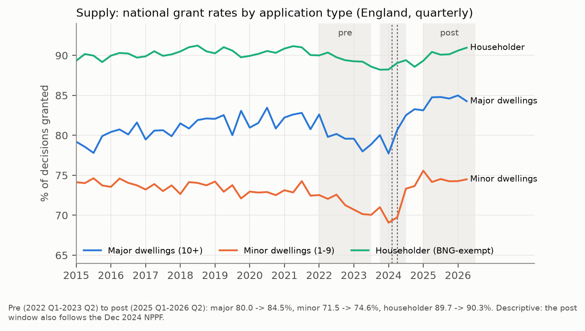
*Figure S5. National grant rates by type.*

### Table S4. National grant rates (%), pre 2022 Q1-2023 Q2 vs post 2025 Q1-2026 Q2 (descriptive)

| type            |   pre |   post |   change (pp) |
|:----------------|------:|-------:|--------------:|
| Householder     | 89.67 |  90.27 |          0.6  |
| Major dwellings | 79.96 |  84.45 |          4.49 |
| Minor dwellings | 71.55 |  74.55 |          3    |

Relative to BNG-exempt householder applications, the dwelling grant rate rose by 3.9 (major)
and 2.4 pp (minor), but the post window falls after the December 2024 NPPF, which the national
series cannot separate from BNG.

### 4.5 England vs Wales (synthetic DiD)

Arkhangelsky et al. (2021) SDID, English councils treated, 21 Welsh councils as donors,
2016 Q1-2026 Q1. Verified three ways (two solvers; uniform weights = 2x2 means; SDID = weighted
TWFE regression).

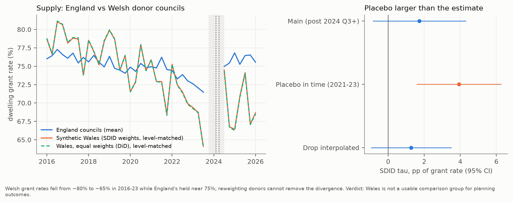
*Figure S6. England vs synthetic Wales, dwelling grant rate; placebo in time larger than the
estimate.*

### Table S5. SDID, English councils vs Welsh donors (jackknife SE; see the two-cluster caveat)

| check                                         | outcome                                |     tau |     se |   tau_did |   eff_donors |   n_wales |   n_england |
|:----------------------------------------------|:---------------------------------------|--------:|-------:|----------:|-------------:|----------:|------------:|
| 1 main                                        | dwelling grant rate [primary]          |  0.0173 | 0.0132 |    0.062  |      20.9874 |        21 |         259 |
| 2 placebo in time (fake post 2021 Q1-2023 Q3) | dwelling grant rate [primary]          |  0.0392 | 0.012  |    0.043  |      20.9969 |        21 |         259 |
| 3 drop interpolated councils                  | dwelling grant rate [primary]          |  0.0128 | 0.0114 |    0.0384 |      16.9955 |        17 |         259 |
| 1 main                                        | minor dwelling grant rate              |  0.0139 | 0.0149 |    0.0627 |      20.986  |        21 |         252 |
| 2 placebo in time (fake post 2021 Q1-2023 Q3) | minor dwelling grant rate              |  0.0368 | 0.0135 |    0.042  |      20.9949 |        21 |         254 |
| 3 drop interpolated councils                  | minor dwelling grant rate              |  0.0105 | 0.0131 |    0.0381 |      16.9958 |        17 |         252 |
| 1 main                                        | log(1+dwelling decisions)              | -0.0485 | 0.0348 |    0.0084 |      20.9904 |        21 |         263 |
| 2 placebo in time (fake post 2021 Q1-2023 Q3) | log(1+dwelling decisions)              |  0.0001 | 0.0357 |    0.0674 |      20.9833 |        21 |         263 |
| 3 drop interpolated councils                  | log(1+dwelling decisions)              | -0.0249 | 0.0414 |    0.0065 |      16.9933 |        17 |         263 |
| 1 main                                        | householder grant rate [placebo]       |  0.0111 | 0.0089 |    0.0157 |      20.9588 |        21 |         263 |
| 2 placebo in time (fake post 2021 Q1-2023 Q3) | householder grant rate [placebo]       |  0.0086 | 0.0053 |    0.0183 |      20.9931 |        21 |         263 |
| 3 drop interpolated councils                  | householder grant rate [placebo]       |  0.0105 | 0.0109 |    0.0174 |      16.9609 |        17 |         263 |
| 1 main                                        | log(1+householder decisions) [placebo] | -0.0335 | 0.0158 |   -0.0224 |      20.9896 |        21 |         263 |
| 2 placebo in time (fake post 2021 Q1-2023 Q3) | log(1+householder decisions) [placebo] | -0.0445 | 0.0119 |   -0.0629 |      20.9909 |        21 |         263 |
| 3 drop interpolated councils                  | log(1+householder decisions) [placebo] | -0.039  | 0.0172 |   -0.0303 |      16.9946 |        17 |         263 |
| 1 main                                        | major dwelling grant rate (annual)     |  0.0391 | 0.0361 |    0.0156 |      15.987  |        16 |         260 |

**Verdict: Wales is not a usable comparison group for planning outcomes.** The placebo in time
(+0.039) exceeds the estimate (+0.017); the unit weights are almost uniform (21.0 effective
donors of 21), so reweighting cannot fix the 2016-23 divergence (Welsh grant rates ~80% ->
~65%, England ~75%). Treatment is by country, so the unit jackknife understates uncertainty
(effectively two clusters). Denbighshire has no data for the whole post-BNG window.

---

## 5. Demand: did gain sites change nearby house prices?

### 5.1 Sites and design

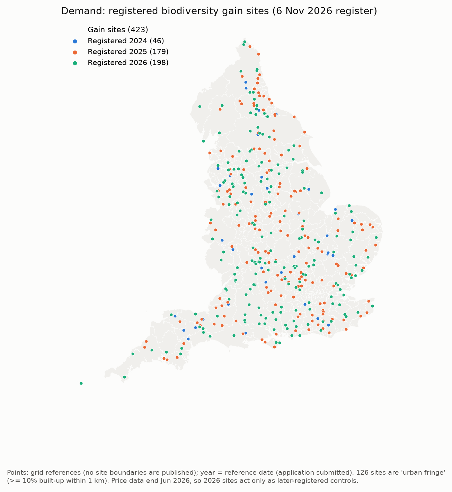
*Figure D1. Registered gain sites, 6 November 2026 register (423 with location).*

Treatment = the date in the register reference (application submitted; before public
listing, which biases estimates towards zero). Sites are points; each is drawn as a disc of
its area, and distance is measured from that edge.

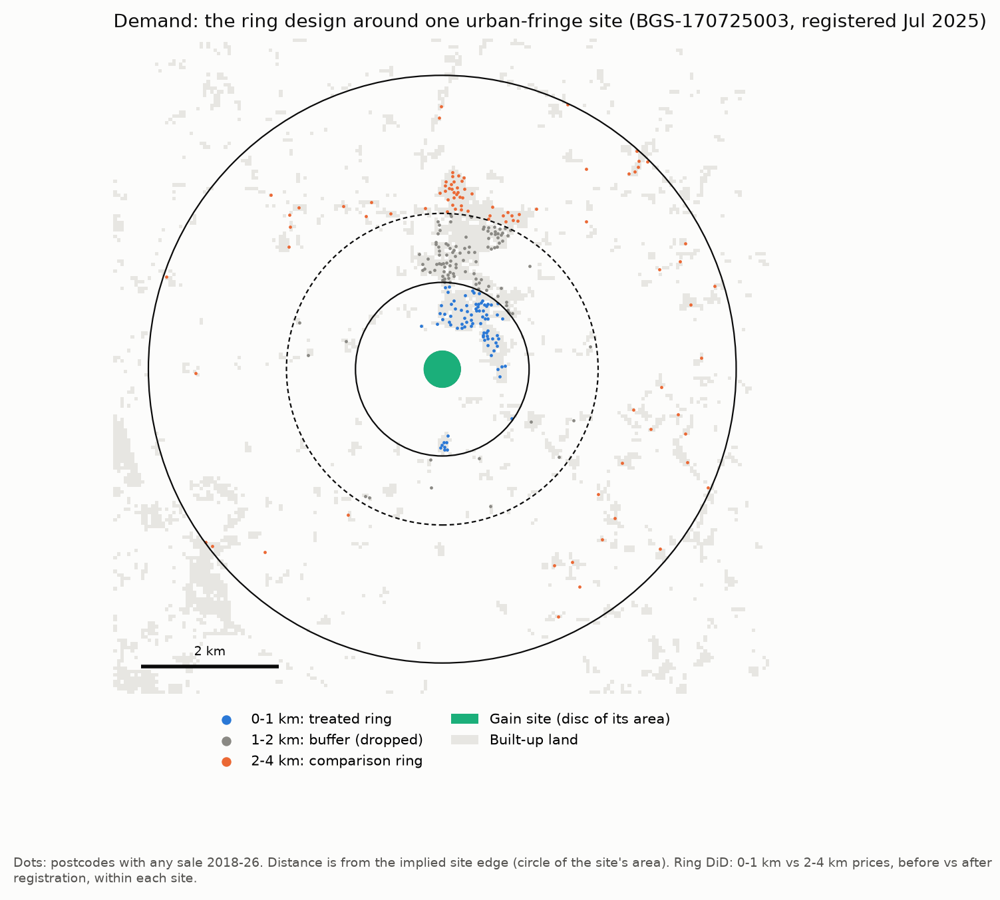
*Figure D2. The ring design around one urban-fringe site.*

Prices are first adjusted nationally: `ln P_i = a_{LAD x quarter} + b_{type x tenure x new} +
u_i` over all 6.66 million sales (2018 to June 2026; R2 0.67); designs use the residual *u*.

| Design | Model | Identifying assumption |
|---|---|---|
| Ring DiD | cell mean u, 0-1 km vs 2-4 km rings, before vs after; FE site x ring, site x quarter; weights = sales; SE by site | inner and outer rings around a site would have moved in parallel |
| Stacked DiD (later sites as controls; zu Ermgassen et al. 2023) | per registration quarter g: treated = sites registered in g, controls = sites registered after g+3; window g-12..g+3; FE stack x site, stack x quarter | prices near early and later registrants would have moved in parallel |
| Synthetic DiD | site x half-year inner-ring price; pseudo-site donors 5-15 km away; cohort SDID, placebo SE | weighted donors reproduce the pre-period path |
| EPC hedonic | sale-level ring DiD with floor area, rooms, age band, energy rating | as ring DiD; rules out composition |
| Callaway-Sant'Anna doubly robust | site x half-year inner-minus-outer price gap; not-yet-treated controls; covariates (area, built-up share, woodland, IMD 2025, 2018-19 price); site bootstrap | parallel trends conditional on covariates |

### 5.2 Results (423-site register)

### Table D1. Gain-site price effects, sales-weighted designs (423-site register)

| Design / spec                                                               |   Sites (treated) |    beta |     SE | % effect [95% CI]   |
|:----------------------------------------------------------------------------|------------------:|--------:|-------:|:--------------------|
| Ring DiD, urban fringe 2024-25                                              |                71 |  0.0003 | 0.0078 | +0.0% [-1.5, +1.6]  |
| Stacked: 1a All sites, inner ring only                                      |               155 |  0.006  | 0.0098 | +0.6% [-1.3, +2.6]  |
| Stacked: 1b All sites, ring DDD (inner vs 2-4 km)                           |               155 |  0.0022 | 0.0122 | +0.2% [-2.1, +2.6]  |
| Stacked: 1c Urban fringe only, inner ring                                   |                56 |  0.0045 | 0.0107 | +0.5% [-1.6, +2.6]  |
| Stacked: 1d Urban fringe only, ring DDD                                     |                56 | -0.0004 | 0.0135 | -0.0% [-2.7, +2.7]  |
| Stacked: 1e Anticipation buffer: controls registered >= 1 year after window |                40 |  0.0282 | 0.0221 | +2.9% [-1.5, +7.4]  |
| Stacked: 1f Treatment = works start if earlier than reference date          |               201 |  0.0026 | 0.0086 | +0.3% [-1.4, +2.0]  |
| Stacked: 1g Existing homes only (no new builds)                             |               155 |  0.0056 | 0.0094 | +0.6% [-1.3, +2.4]  |
| EPC: 2a-i Matched sample, pilot controls only (type, tenure, new)           |                71 |  0.0005 | 0.0081 | +0.1% [-1.5, +1.7]  |
| EPC: 2a-ii + log floor area, rooms, age band, energy rating                 |                71 |  0.004  | 0.007  | +0.4% [-1.0, +1.8]  |
| EPC: 2b Outcome: log price per m2 (+ same controls except area)             |                71 |  0.0039 | 0.0075 | +0.4% [-1.1, +1.9]  |
| EPC: 2c-i Composition: log floor area of homes sold                         |                71 | -0.0085 | 0.0084 | -0.8% [-2.5, +0.8]  |
| EPC: 2c-ii Composition: share built 2012 or later                           |                71 | -0.0076 | 0.0099 | -0.8% [-2.7, +1.2]  |
| SDID, pseudo-site donors, seed 7                                            |                63 |  0.0032 | 0.0088 | +0.3% [-1.4, +2.1]  |
| SDID, mean of 40 donor draws (SE: placebo and draw SD combined)             |                63 | -0.0047 | 0.0095 | -0.5% [-2.3, +1.4]  |

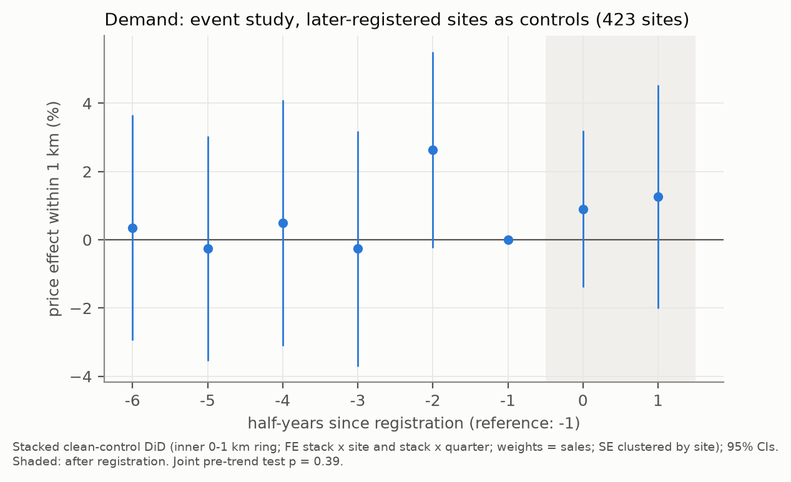
*Figure D3. Event study, later-registered sites as controls; joint pre-trend test p = 0.39.*

### Table D2. Callaway-Sant'Anna doubly robust (site x half-year; bootstrap B = 499)

| spec                                        |    att |   se_boot |   ci90_lo |   ci90_hi | equivalent_3pct   |   pretrend_p |   treated_sites |   n_sites |
|:--------------------------------------------|-------:|----------:|----------:|----------:|:------------------|-------------:|----------------:|----------:|
| Main: DR, full covariates, delta 1          | -0.023 |     0.031 |    -0.079 |     0.02  | False             |        0.457 |             192 |       355 |
| R1 No covariates                            | -0.029 |     0.031 |    -0.083 |     0.019 | False             |        0.515 |             192 |       355 |
| R2 delta 0 (base g-1)                       | -0.005 |     0.029 |    -0.056 |     0.04  | False             |        0.853 |             192 |       355 |
| R3 Existing homes only                      | -0.031 |     0.031 |    -0.082 |     0.019 | False             |        0.595 |             192 |       355 |
| R4 Urban-fringe sites only                  | -0.05  |     0.048 |    -0.107 |     0.021 | False             |        0.207 |              69 |       123 |
| R5 Drop two 1 km sites                      | -0.023 |     0.031 |    -0.079 |     0.02  | False             |        0.457 |             192 |       355 |
| W Main: DR, full covariates, sales-weighted | -0.008 |     0.05  |    -0.107 |     0.049 | False             |        0.296 |             192 |       355 |
| W-R1 No covariates                          | -0.03  |     0.02  |    -0.066 |    -0     | False             |        0.034 |             192 |       355 |
| W-R2 delta 0 (base g-1)                     | -0.017 |     0.037 |    -0.078 |     0.028 | False             |        0.119 |             192 |       355 |
| W-R3 Existing homes only                    |  0.001 |     0.043 |    -0.071 |     0.059 | False             |        0.406 |             192 |       355 |
| W-R4 Urban-fringe sites only                | -0.01  |     0.082 |    -0.132 |     0.076 | False             |        0.146 |              69 |       123 |

(ATT and intervals in log points. R5 equals the main specification because both 1 km sites
were already dropped for lacking 2018-19 sales. The sales-weighted rows were pre-specified
after the unweighted run and are reported as such.)

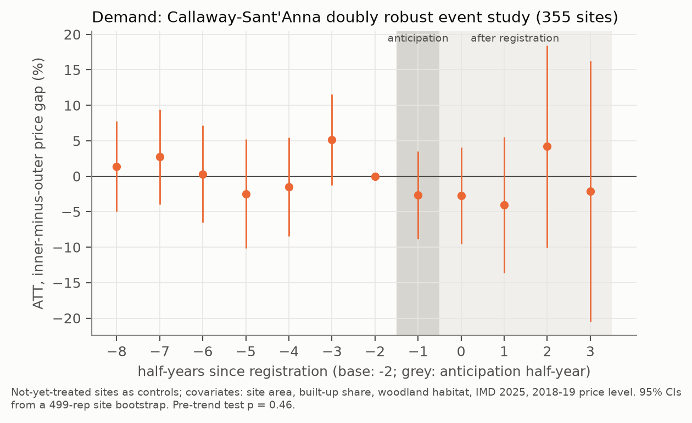
*Figure D5. Callaway-Sant'Anna event study (base half-year -2; -1 is the anticipation
half-year); pre-trend test p = 0.46.*

### Table D3. Equivalence (TOST) against +/-3% (+/-0.0296 log points), 90% CI

| design                                                    |   beta |     se |   ci90_lo |   ci90_hi | equivalent_3pct   |
|:----------------------------------------------------------|-------:|-------:|----------:|----------:|:------------------|
| T1 ring DiD (urban fringe 2024-25)                        | 0.0003 | 0.0078 |   -0.0125 |    0.0132 | True              |
| 1a All sites, inner ring only                             | 0.006  | 0.0098 |   -0.0101 |    0.0221 | True              |
| 1f Treatment = works start if earlier than reference date | 0.0026 | 0.0086 |   -0.0116 |    0.0168 | True              |

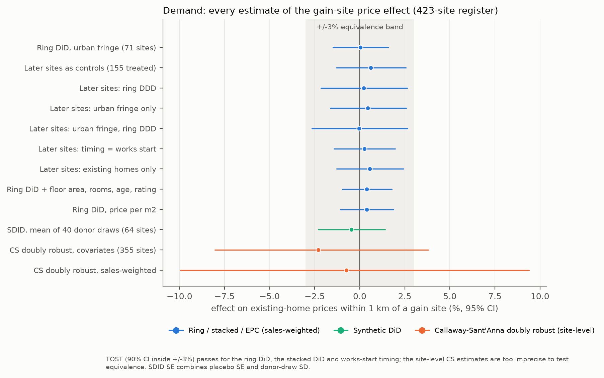
*Figure D4. Every demand estimate with 95% CI and the +/-3% equivalence band.*

**Reading.**
- *A precise null for existing homes near gain sites.* In the sales-weighted ring and stacked
  designs, price effects larger than +/-3% are rejected at the 5% level (TOST, Lakens 2017).
  Point estimates lie between -0.0% and +0.6% (the anticipation-buffer specification, with
  40 treated sites, is +2.9%, insignificant); EPC controls change nothing and the homes sold
  did not become larger or newer.
- *Callaway-Sant'Anna* (staggered timing, selection on covariates) agrees on the absence of
  an effect (-2.3%, SE 3.1%; pre-trends p = 0.46), but at the site level it is too imprecise
  to test equivalence (MDE about 8.7%). Weighting by pre-BNG sales made it less precise, not
  more (86 effective sites of 355).
- *Model:* consistent with eta small (much of the created habitat is grassland enhancement,
  Duffus et al. 2025) and with the cost channel falling on land rather than on the existing
  stock. The application-date treatment biases towards zero; overlapping sites share rings.

---

## 6. Biodiversity: what eBird can and cannot say

*Feasibility (counts only, thresholds written first).* 3.57 m GB checklists; 1.43 m usable and
in England. Within 1 km of a gain site the median site has **2** complete checklists in
2018-23 (134 sites none); only **26** of 225 treated sites have enough lists before and after
registration (threshold 50). **An impact estimate is not feasible**, quite apart from habitat
created in 2024-26 barely having started to change. The intensity cross-check missed its
threshold (128 of 205 councils vs 150) and was not run.

*Selection test (feasible on 124 well-surveyed sites).* Were future gain sites already
bird-rich? Species per complete checklist, 0-1 km vs 2-4 km of the same site, 2015-23 (before
any registration), PPML with site FE and effort controls (duration, distance, observers,
protocol, start hour, month, year), SE by site.

### Table B1. Bird species per checklist near future gain sites vs 2-4 km, 2015-23 (PPML, site FE)

| spec                                                |   beta |     se | % [95% CI]           |   sites |   rows | reading                  |
|:----------------------------------------------------|-------:|-------:|:---------------------|--------:|-------:|:-------------------------|
| 1 Main: richness, 0-1 km vs 2-4 km, effort controls | 0.0603 | 0.0486 | +6.2% [-3.4, +16.8]  |     124 |  66598 | inconclusive             |
| 2 No effort controls                                | 0.0617 | 0.0518 | +6.4% [-3.9, +17.7]  |     124 |  66598 | inconclusive             |
| 3 0-500 m vs 2-4 km                                 | 0.1123 | 0.0745 | +11.9% [-3.3, +29.5] |     124 |  59710 | inconclusive             |
| 4 All sites with checklists in both rings           | 0.0535 | 0.0472 | +5.5% [-3.8, +15.7]  |     298 | 100203 | inconclusive             |
| 5 Farmland Bird Index species                       | 0.1369 | 0.0537 | +14.7% [+3.2, +27.4] |     124 |  66598 | richer near future sites |

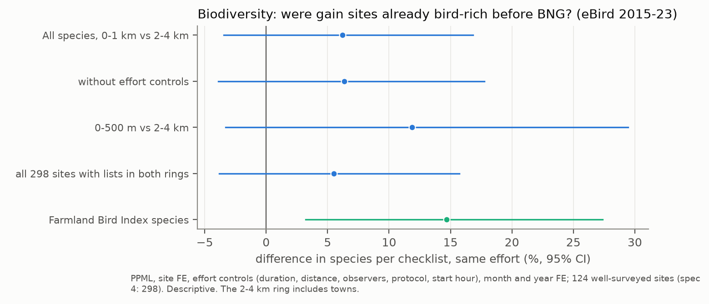
*Figure B1. Effort is balanced across rings (69 min, 1.4 km, 1.4 observers per checklist).*

**Reading.** No clear evidence that gain sites sit on already bird-rich land overall (+6%,
inconclusive). They do sit in farmland with about 15% more farmland-bird species than their
surroundings (suggestive: one of five comparisons, p about 0.011; the outer ring includes
towns). For additionality (rho): offsets are not placed on biologically empty land.
Descriptive only; well-surveyed sites only.

---

## 7. Caveats that apply throughout

- **Treatment timing.** Register dates are application dates; public listing comes later and
  works start a median ~11 months earlier. Repeated register pulls could measure the lag.
- **Outcomes are decisions, not applications.** A "fewer schemes come forward" channel is
  only seen indirectly (grant rate).
- **Confounders in the post period:** December 2024 NPPF, April 2025 fee and stamp-duty changes.
  Region x quarter effects absorb regional versions only.
- **Inference:** clustered at the unit of treatment (LPA, site); the England-Wales contrast is
  effectively two clusters. Gain sites overlap, so site clusters are not fully independent.
- **Measurement:** Living England is modelled, with class errors and no condition data; the
  crosswalk to statutory distinctiveness is a judgement (TODO: verify against the metric).

## 8. Decisions for Ben, and next steps

1. **Main supply specification:** with region x quarter FE the grant-rate effect is +1.7 pp
   per SD (p = 0.01); without, +0.8 pp (p = 0.20). Which is the preferred specification?
2. **Scope:** supply + demand + model, plus the descriptive biodiversity check; what to cut.
3. **Equivalence bound:** +/-3% for prices (used here); a bound for planning outcomes is not
   yet agreed.
4. Next empirical steps (FINDINGS 7): measure *s* (share of BNG-liable developments buying
   off-site) by matching register allocations (3,437 rows, all with planning references) to
   planning data; applications by type; the land-value test (P5).

## 9. Reproducing everything

From `Dissertation/Pipeline/`, with `~/miniforge3/envs/bng-diss/bin/python`:

```
python src/register.py 2026-11-06_BNG_Register
python src/register.py BNG_Register_snapshot_2026-10-12
python src/planning_panel.py
python src/pilot1_rates.py
python src/intensity_grid.py units
python src/intensity_grid.py habitat
python src/intensity_score.py
python src/intensity_did.py
python src/nutrient_neutrality.py
python src/intensity_robustness.py
python src/sdid.py
python src/housing_inputs.py
python src/hedonic_base.py
python src/gainsite_context.py 2026-11-06_BNG_Register sites
python src/gainsite_did.py 2026-11-06_sites
python src/gainsite_sdid.py 2026-11-06_sites draws
python src/epc_extract.py 2026-11-06_sites
python src/gainsite_epc.py 2026-11-06_sites
python src/gainsite_cs.py 499
python src/gainsite_cs.py 499 weighted
python src/ebird_counts.py
python src/ebird_species.py
python src/ebird_selection.py
python src/report_tables.py
python src/figures.py
python -m pytest tests -p no:cacheprovider
```

*References cited above (Arkhangelsky et al. 2021; Callaway and Sant'Anna 2021; Sant'Anna and
Zhao 2020; Goodman-Bacon 2021; Roth 2024; Lakens 2017; zu Ermgassen et al. 2023; Duffus et al.
2025; Gibbons, Mourato and Resende 2014; Johnston et al. 2021; Cengiz et al. 2019): TODO: verify every
citation before it goes into the write-up.*
